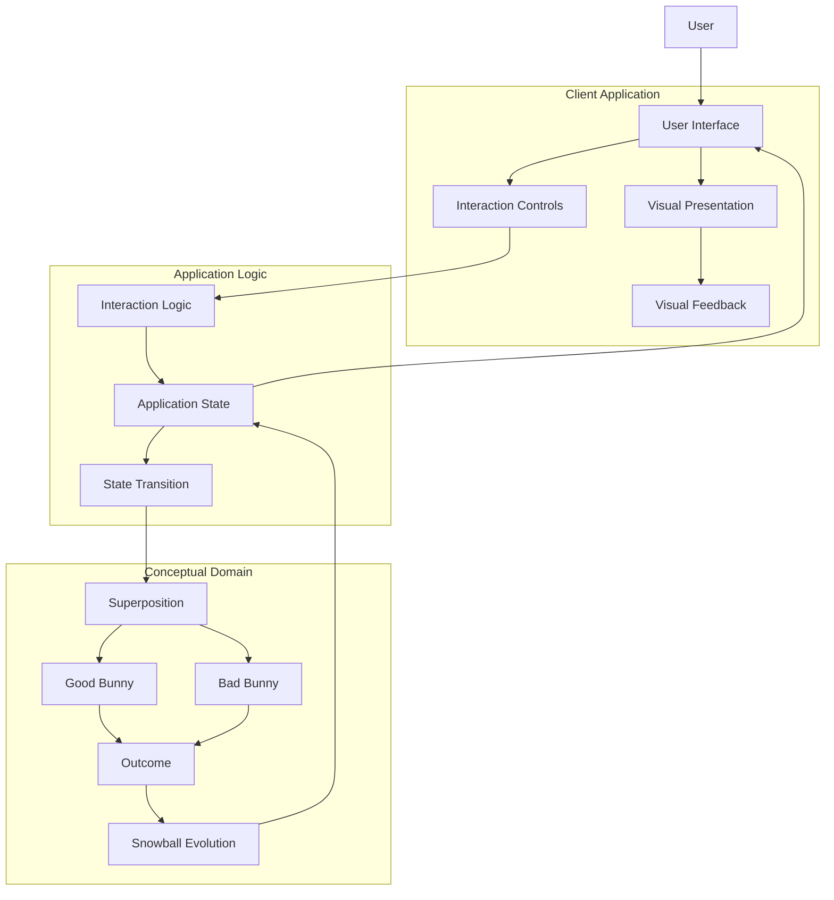
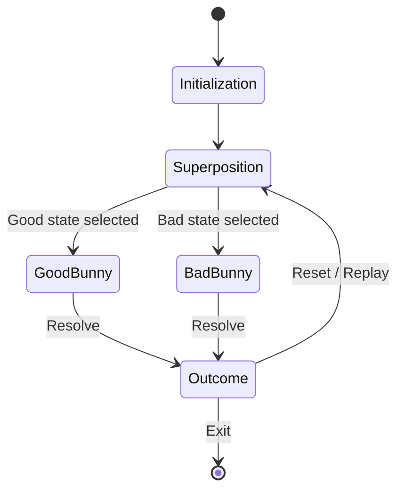
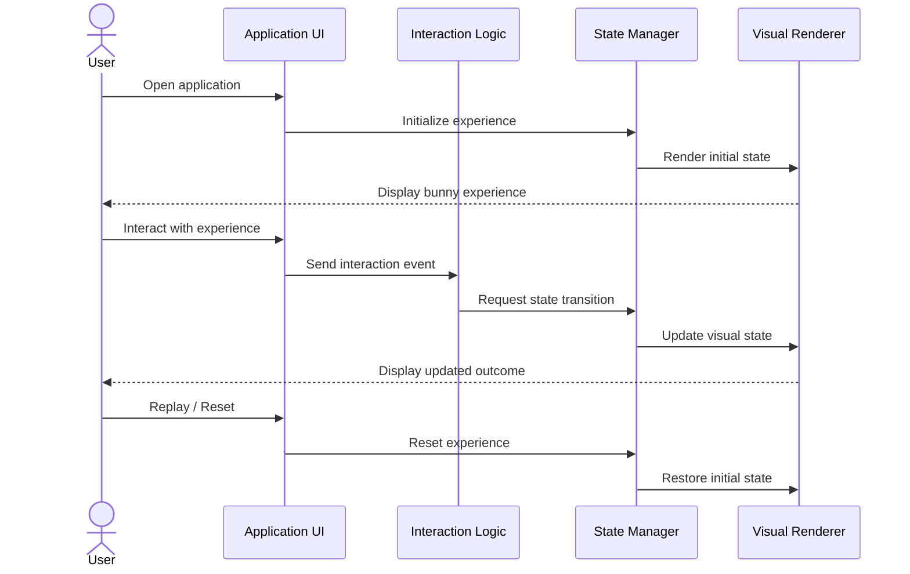
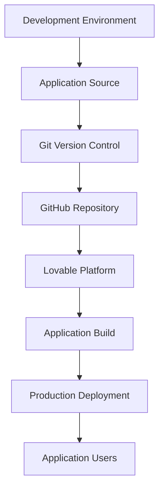
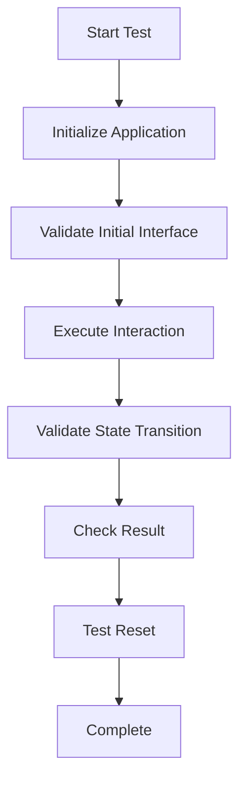

# 🐰 Snowball Superposition: Good Bunny vs. Bad Bunny

<p align="center">
  <h3>An Interactive Exploration of Duality, Superposition, and Emergent Outcomes</h3>
  <p>Two opposing possibilities. One evolving system. An unexpected outcome.</p>
</p>

<p align="center">
  <a href="https://bunny-superposition.lovable.app/">Live Demo</a> •
  <a href="https://github.com/lucylow/snowball-superposition-good-bunny-vs-bad-bunny">Source Repository</a> •
  <a href="https://lovable.dev/">Built with Lovable</a>
</p>

---

## 1. Project Overview

**Snowball Superposition: Good Bunny vs. Bad Bunny** is a creative interactive application exploring the relationship between opposing states, uncertainty, and outcomes through a playful bunny-based metaphor.

The project uses two contrasting characters:

- 🐰 **Good Bunny:** Represents one possible state.
- 🐇 **Bad Bunny:** Represents an alternative, opposing state.

The central idea draws inspiration from the quantum mechanical concept of superposition: a system can be represented as a combination of possible states before measurement.

The application translates this abstract concept into an accessible digital experience.

Rather than presenting quantum mechanics as a purely mathematical subject, the project uses character-driven interaction and visual storytelling to communicate the idea of competing possibilities.

### Project information

| Property | Details |
|---|---|
| Project | Snowball Superposition |
| Repository | `snowball-superposition-good-bunny-vs-bad-bunny` |
| Owner | `lucylow` |
| Hosting / development platform | Lovable |
| Repository visibility | Public |
| Default branch | `main` |
| Live application | https://bunny-superposition.lovable.app/ |
| Source package | Lovable project ZIP |

---

## 2. Core Concept

### 2.1 The superposition metaphor

Superposition is a fundamental principle of quantum mechanics.

A quantum system can exist in a combination of possible states. When an appropriate measurement is performed, an observable result is obtained.

In this project, the two bunny characters provide a simplified visual analogy.

```text
                  QUANTUM-INSPIRED MODEL

                     Initial System
                           |
                           v
                  Superposition State
                           |
                 +---------+---------+
                 |                   |
                 v                   v
             Good Bunny          Bad Bunny
              | Possible State A   | Possible State B
                 |                   |
                 +---------+---------+
                           |
                           v
                     Interaction
                           |
                           v
                   Observed Outcome
```

This is a conceptual analogy, not a physical quantum simulation.

### 2.2 Why a snowball?

The snowball metaphor can represent an evolving process in which small interactions contribute to a larger outcome.

It provides a useful way to think about:

- Accumulation of events.
- Changes in system state.
- Interactions between alternatives.
- Emergence of an observable result.
- The evolution of possibilities over time.

### 2.3 Conceptual state model

| Element | Conceptual meaning |
|---|---|
| Good Bunny | Positive alternative |
| Bad Bunny | Opposing alternative |
| Superposition | Multiple possible states |
| Interaction | User-driven event |
| Snowball | Evolving or accumulating process |
| Outcome | Resolved observable state |

---

## 3. System Architecture

The following architecture represents the logical structure of the experience. It is a reference architecture, not a verified inventory of the application's internal source-code modules.

### 3.1 High-level architecture



### 3.2 Architecture responsibilities

| Component | Responsibility |
|---|---|
| User interface | Presents the interactive experience |
| Visual presentation | Displays characters and conceptual states |
| Interaction controls | Captures user actions |
| Application state | Represents the current experience state |
| Interaction logic | Processes application events |
| State transition | Changes the current conceptual state |
| Outcome | Represents the resulting experience |
| Visual feedback | Communicates changes to the user |

### 3.3 Application architecture principles

A maintainable implementation should separate:

1. Presentation from application logic.
2. User input from state transitions.
3. Conceptual domain data from visual rendering.
4. Application configuration from source code.
5. Development configuration from production configuration.

This separation makes the project easier to extend and test.

---

## 4. State Management and Interaction Flow

The central technical idea is the transition between alternative states.

### 4.1 State lifecycle



### 4.2 State transition model

A simple conceptual state machine can be represented as:

```typescript
type BunnyState =
  | "initial"
  | "superposition"
  | "good"
  | "bad"
  | "outcome";

interface ExperienceState {
  currentState: BunnyState;
  interactionCount: number;
}

const initialState: ExperienceState = {
  currentState: "initial",
  interactionCount: 0,
};
```

An example transition function:

```typescript
type BunnySelection = "good" | "bad";

function transitionState(
  current: ExperienceState,
  selection: BunnySelection
): ExperienceState {
  return {
    currentState: selection,
    interactionCount: current.interactionCount + 1,
  };
}
```

This example illustrates a possible implementation pattern. It does not claim that the existing application uses this exact TypeScript model.

### 4.3 Interaction sequence



---

## 5. Repository Structure

The publicly visible repository contains:

```text
snowball-superposition-good-bunny-vs-bad-bunny/
│
├── README.md
│
└── lovable-project-44a5f05d-d8af-4cdc-9e1d-dba28e00cbd4-2026-11-08.zip
```

The ZIP archive contains the exported Lovable project.

The following is a suggested logical structure for the extracted application, not a verified listing of files inside the archive:

```text
project/
│
├── public/
│   └── assets/
│
├── src/
│   ├── components/
│   │   ├── Bunny/
│   │   ├── Snowball/
│   │   └── UI/
│   │
│   ├── pages/
│   │
│   ├── hooks/
│   │
│   ├── services/
│   │
│   ├── styles/
│   │
│   ├── types/
│   │
│   ├── App.tsx
│   └── main.tsx
│
├── package.json
├── index.html
└── README.md
```

---

## 6. Getting Started

### Prerequisites

For local development, the following tools may be required depending on the exported project's actual framework:

- Git
- Node.js
- npm, pnpm, or Bun
- Visual Studio Code or another code editor
- A modern web browser

### Step 1: Clone the repository

```bash
git clone https://github.com/lucylow/snowball-superposition-good-bunny-vs-bad-bunny.git
```

### Step 2: Enter the project directory

```bash
cd snowball-superposition-good-bunny-vs-bad-bunny
```

### Step 3: Extract the Lovable project

```bash
unzip lovable-project-44a5f05d-d8af-4cdc-9e1d-dba28e00cbd4-2026-11-08.zip -d project
```

### Step 4: Install dependencies

Navigate to the extracted application directory containing `package.json`.

```bash
cd project
npm install
```

If the project uses another package manager, follow its corresponding lockfile.

### Step 5: Start local development

Inspect the `scripts` section of `package.json`.

For projects configured with a Vite development server, the usual command is:

```bash
npm run dev
```

Open the local development URL displayed in the terminal.

**Important:** The commands above are a conditional workflow. Confirm the extracted project's actual configuration before executing them.

---

## 7. Deployment Architecture

The project has a publicly accessible Lovable-hosted application.

Live application:

https://bunny-superposition.lovable.app/

### Deployment flow



This represents a general development and deployment workflow. Actual CI/CD integration, build configuration, and deployment triggers depend on the project settings.

---

## 8. Technical Design Considerations

### 8.1 Modularity

The application should maintain separation between visual components, interaction handlers, and domain logic.

### 8.2 State consistency

State transitions should be predictable and produce consistent interface updates.

### 8.3 Performance

Animations and visual updates should avoid unnecessary rendering and excessive resource consumption.

### 8.4 Accessibility

Recommended accessibility considerations include:

- Keyboard navigation.
- Descriptive labels for interactive elements.
- Sufficient color contrast.
- Accessible animation behavior.
- Screen-reader-friendly content.
- Responsive layouts.

### 8.5 Security

If external services or APIs are introduced:

- Never commit API credentials.
- Store secrets outside the frontend bundle.
- Validate externally supplied data.
- Keep dependencies updated.
- Use HTTPS for production deployments.

---

## 9. Testing Strategy

A useful testing strategy should validate the application from both functional and visual perspectives.

| Test category | Validation |
|---|---|
| Initialization | Application loads successfully |
| Interface | Visual components render correctly |
| Interaction | User controls respond correctly |
| State management | Transitions produce expected states |
| Reset | Application returns to its initial state |
| Responsive design | Interface works on mobile and desktop |
| Accessibility | Controls can be accessed and understood |
| Performance | Rendering and animations remain responsive |

### Testing workflow



---

## 10. Future Development Roadmap

Potential development directions include:

| Feature | Description | Priority |
|---|---|---|
| Extended bunny states | Introduce additional conceptual states | Medium |
| State visualization | Display state transitions visually | High |
| Snowball progression | Explore accumulating interactions | High |
| Animation enhancements | Improve visual transitions | Medium |
| Educational mode | Explain superposition concepts | Medium |
| Interaction history | Display previous user interactions | Medium |
| Accessibility improvements | Expand keyboard and screen-reader support | High |
| Automated testing | Introduce regression testing | High |

These are proposed enhancements, not a declaration of existing functionality.

---

## 11. Contributing

Contributions and suggestions are welcome.

### Development workflow

1. Fork the repository.
2. Create a feature branch.
3. Make your changes.
4. Test your implementation.
5. Commit your changes.
6. Submit a pull request.

Example:

```bash
git checkout -b feature/new-feature

git add .

git commit -m "Add new feature"

git push origin feature/new-feature
```

Please include a description of the change, its purpose, and any relevant testing information.

---

## 12. References and Resources

- [Project Repository](https://github.com/lucylow/snowball-superposition-good-bunny-vs-bad-bunny)
- [Live Application](https://bunny-superposition.lovable.app/)
- [Lovable](https://lovable.dev/)
- [Git Documentation](https://git-scm.com/doc)
- [Mermaid Diagram Documentation](https://mermaid.js.org/)
- [Quantum Superposition](https://en.wikipedia.org/wiki/Quantum_superposition)

---

## 13. License

No explicit open-source license has been verified for this repository.

Please consult the repository owner before redistributing or reusing project code and assets. An appropriate `LICENSE` file should be added if the project is intended for open-source distribution.

---

## 14. Project Summary

Snowball Superposition: Good Bunny vs. Bad Bunny explores the relationship between alternative possibilities, interactions, and outcomes through an approachable visual metaphor.

The project combines creative storytelling with ideas inspired by quantum mechanics, offering an opportunity to explore abstract concepts through an interactive digital experience.

**Two bunnies. Two possibilities. One evolving experience.**

<p align="center">
  🐰 Made with curiosity, creativity, and a little quantum inspiration. ❄️
</p>

<p align="center">
  <a href="https://bunny-superposition.lovable.app/">Launch the Application</a>
</p>
